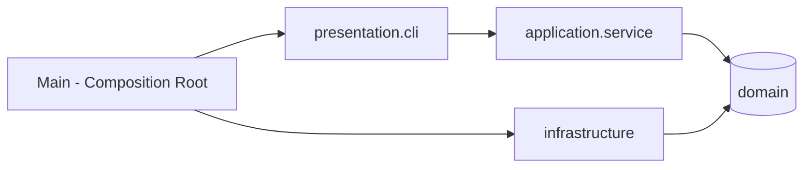

<h1 align="center">✅ TodoList Avançado — Java Puro</h1>

<p align="center">
  Gerenciador de tarefas em <b>Java SE 21</b>, sem frameworks, construído para demonstrar
  <b>POO sólida</b>, <b>Design Patterns</b> e <b>Clean Code</b>.
</p>

<p align="center">
  
  
  
  
</p>

---

## 📌 Sobre o Projeto

Aplicação Java para gerenciar tarefas com prioridades, prazos, ciclo de vida controlado e
lembretes automáticos em segundo plano. Mostra como **recursos nativos do Java** e **boa
arquitetura** resolvem problemas reais sem depender de frameworks.

## ✨ Funcionalidades Principais

- 💻 **Menu interativo no terminal** (você digita e a aplicação responde)
- 📝 Criar, listar, reagendar e remover tarefas
- 🔄 Ciclo de vida com **máquina de estados** (Pendente → Em andamento → Concluída/Cancelada)
- 🎯 Prioridades (Baixa a Crítica) e ordenação inteligente
- 🔍 **Filtros combináveis** via Specification Pattern
- ⏰ **Lembretes em background** com `ScheduledExecutorService`
- 📊 Estatísticas por status com Stream API
- 🔔 Eventos de domínio (Observer) com `sealed interface` e `records`

## 🛠️ Tecnologias e Conceitos

| Categoria | Detalhes |
|---|---|
| Linguagem | Java 21 (records, sealed, pattern matching) |
| Build | Maven |
| Testes | JUnit 5 (escopo `test`) |
| API Java SE | `java.time`, Streams, Generics, Optional, `java.util.concurrent` |
| Patterns | Repository, Builder, Observer, Specification, Strategy, State |
| Princípios | SOLID, DIP, Clean Code, Tell-Don't-Ask |

## 🏗️ Arquitetura



Detalhes em [`docs/arquitetura.md`](docs/arquitetura.md).

## 🚀 Como Executar

**Pré-requisitos:** JDK 21+ e Maven 3.9+

```bash
git clone https://github.com/seu-usuario/todolist-java.git
cd todolist-java

mvn clean package
java -jar target/todolist-java-1.0.0.jar
```

Rodar apenas os testes: `mvn test`

## 🖥️ Como Usar

Ao executar, o menu interativo aparece e você digita as opções:

```
══════════ GERENCIADOR DE TAREFAS ══════════
  1) Criar tarefa
  2) Listar tarefas
  3) Iniciar tarefa
  4) Concluir tarefa
  5) Cancelar tarefa
  6) Reagendar prazo
  7) Remover tarefa
  8) Filtrar tarefas
  9) Ver tarefas atrasadas
 10) Estatísticas
  0) Sair
════════════════════════════════════════════
Escolha uma opção:
```

- **Prazo:** formato `dd/MM/yyyy HH:mm` (ex.: `25/12/2026 18:30`). Enter deixa a tarefa sem prazo.
- **Lembretes:** uma thread em background avisa, uma única vez, tarefas que vencem na próxima hora.
- **Persistência:** os dados ficam em memória e são perdidos ao sair (veja o roadmap).

## 🗺️ Roadmap

- [ ] Persistência em arquivo (`java.nio.file`)
- [ ] Desfazer/refazer (Command Pattern)
- [ ] Tags e subtarefas (Composite)

## 👤 Autor

**Elton** — [LinkedIn](https://www.linkedin.com/in/elton-henrique-da-silva-335aa8244/)
